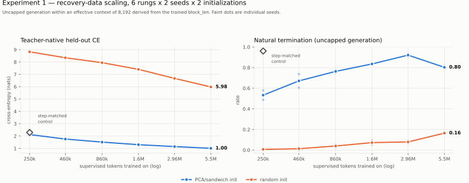

# AlphaAvatar-distill

## Overview and Goals

AlphaAvatar-distill is an agent-guided framework for compressing large teacher
models into smaller, efficient student models. Its purpose is reproducible,
configurable model compression and distillation for real-time and edge
deployment: every experiment is driven by a logged configuration, command, code
state and data identity, so another person or agent can reproduce or continue it.

The primary capability objective is **fluid reasoning and adaptive
problem-solving**:

> Given unfamiliar problems, a student should use information supplied by the
> task or acquired through interaction to discover rules, form abstractions,
> reason deductively and compositionally, and generalize to produce correct
> answers or complete tasks.

Knowledge retention is a supporting capability, not a replacement for
reasoning ([`AGENTS.md`](./AGENTS.md) P10.2).

The framework is designed to extend across model sizes, architectures,
compression ratios and deployment environments: the reusable core in
`src/aadistill/` takes models, targets and budgets as inputs rather than
hard-coding them. The work so far is a dense text baseline, distilling
[Qwen3-4B-Thinking-2507](https://huggingface.co/Qwen/Qwen3-4B-Thinking-2507)
into a sub-1B student. Other model families, MoE and multimodal models are
design goals and have not been validated.

## Performance Trend

[](./assets/e1_scaling.svg)

Performance is judged from recorded experimental evidence. Reasoning
correctness on unseen tasks is reported separately from rollout reliability
(whether the student produces well-formed, terminating output) and from runtime
efficiency, and none of them stands in for another.

Detailed results: the [experiment index](./logs/state/experiment_index.md), the
[current state](./logs/state/current.md) and the
[documentation](./docs/README.md).

## Running the Agent

AlphaAvatar-distill is developed and operated through coding agents such as
Claude Code, Codex or Cursor. Open the repository with your agent and describe
what you want in natural language. The agent reads [`AGENTS.md`](./AGENTS.md),
the working contract for this repository, and inspects the code and the
experiment evidence before it changes anything. Paid, long-running or
public-facing actions are proposed for your approval first.

**Introduce the project**

> Read this repository and introduce AlphaAvatar-distill. Explain its goals, main capabilities, overall architecture, and current development status. Distinguish implemented functionality from planned features.

**Explain how it works**

> Explore the AlphaAvatar-distill codebase and explain how it works, from a teacher model checkpoint through calibration, structural initialization, distillation, student recovery, evaluation, and deployment. Keep the explanation high-level and point me to the relevant components.

**Start a model compression experiment**

> Hi, have a look at the AlphaAvatar-distill repo and start from the teacher model https://huggingface.co/Qwen/Qwen3-4B-Thinking-2507. Let's kick off the first dense-model compression experiment.

**Compress a custom model**

> I want to distill a teacher model into a smaller student for real-time inference. Explore the repository, help me choose an appropriate target architecture and compression ratio, and propose a reproducible training and evaluation plan.

**Continue an existing experiment**

> Review the latest repository state and experiment evidence, identify the next steps, and continue the currently authorized workflow. Reuse valid checkpoints and previously generated data instead of repeating completed work.

## Project Structure

| path | contents |
| --- | --- |
| `src/aadistill/` | reusable algorithm and framework code |
| `scripts/` | experiment and workflow entry points, by stage |
| `configs/` | model and experiment configurations |
| `data/` | datasets and evaluation assets, including the permanent evaluation registry |
| `tests/` | tests of the reusable core |
| `logs/` | experiment history and evidence, by stage and experiment |
| `artifacts/` | generated outputs and model artifacts (kept out of git) |
| `docs/` | technical and research documentation |
| `assets/` | figures and the data they are rendered from |
| `AGENTS.md` | instructions for coding agents |

Details: [`docs/maintenance/REPO_LAYOUT.md`](./docs/maintenance/REPO_LAYOUT.md).

## Optim Record History

An official optimization record is stricter than an experiment result: it needs
the exact commit, command, hardware, data and tokenizer identities, budget,
metric log, final evaluation and maintainer approval ([`AGENTS.md`](./AGENTS.md)
§3.8). Experiment results, however strong, are not records.

| stage | official record |
| --- | --- |
| Stage 0 — initialization warm-up data collection | No official record yet |
| Stage 1 — projection and structural initialization | No official record yet |
| Stage 2 — offline warm-up data collection | No official record yet |
| Stage 3 — student recovery | No official record yet |
| Stage 4 — online data collection | No official record yet |
| Stage 5 — on-policy distillation | No official record yet |
| Stage 6 — deployment validation | No official record yet |

## References

- Muralidharan et al., *Compact Language Models via Pruning and Knowledge Distillation* (Minitron), 2024. [arXiv:2407.14679](https://arxiv.org/abs/2407.14679)
- Gromov et al., *The Unreasonable Ineffectiveness of the Deeper Layers*, 2024. [arXiv:2403.17887](https://arxiv.org/abs/2403.17887)
- Xia et al., *Sheared LLaMA: Accelerating Language Model Pre-training via Structured Pruning*, 2023. [arXiv:2310.06694](https://arxiv.org/abs/2310.06694)
- Kim & Rush, *Sequence-Level Knowledge Distillation*, EMNLP 2016. [arXiv:1606.07947](https://arxiv.org/abs/1606.07947)
- Zelikman et al., *STaR: Bootstrapping Reasoning With Reasoning*, NeurIPS 2022. [arXiv:2203.14465](https://arxiv.org/abs/2203.14465)
- Yuan et al., *Scaling Relationship on Learning Mathematical Reasoning with Large Language Models*, 2023. [arXiv:2308.01825](https://arxiv.org/abs/2308.01825)
- Ding et al., *Fewer Truncations Improve Language Modeling*, ICML 2024. [arXiv:2404.10830](https://arxiv.org/abs/2404.10830)
- Krell et al., *Efficient Sequence Packing without Cross-contamination*, 2021. [arXiv:2107.02027](https://arxiv.org/abs/2107.02027)
- Yu et al., *DAPO: An Open-Source LLM Reinforcement Learning System at Scale*, 2025. [arXiv:2503.14476](https://arxiv.org/abs/2503.14476)
- Liu et al., *Defeating the Training-Inference Mismatch via FP16*, 2025. [arXiv:2510.26788](https://arxiv.org/abs/2510.26788)
- LMSYS, *Towards Deterministic Inference in SGLang and Reproducible RL Training*, 2025. [lmsys.org](https://www.lmsys.org/blog/2025-09-22-sglang-deterministic/)
- vLLM team, *No More Train-Inference Mismatch: Bitwise Consistent On-Policy RL with vLLM and TorchTitan*, 2025. [blog.vllm.ai](https://blog.vllm.ai/2025/11/10/bitwise-consistent-train-inference.html)
- Hugging Face, *Native-speed vLLM transformers modeling backend*, 2026. [huggingface.co/blog](https://huggingface.co/blog/native-speed-vllm-transformers-backend)
- DeepSeek, *nano-vLLM*, 2025. [huggingface.co/blog](https://huggingface.co/blog/zamal/introduction-to-nano-vllm)
- Karpathy, *nanochat*, 2025. [github.com/karpathy/nanochat](https://github.com/karpathy/nanochat)

## Citation

If you use AlphaAvatar-distill in your research or projects, please cite it as:

```bibtex
@misc{alphaavatar_distill_2026,
  author       = {Licheng Wang and AlphaAvatar Contributors},
  title        = {AlphaAvatar-distill: Agentic Model Compression for Realtime and Edge AI Assistants},
  year         = {2026},
  url          = {https://github.com/AlphaAvatar/AlphaAvatar-distill}
}
```
